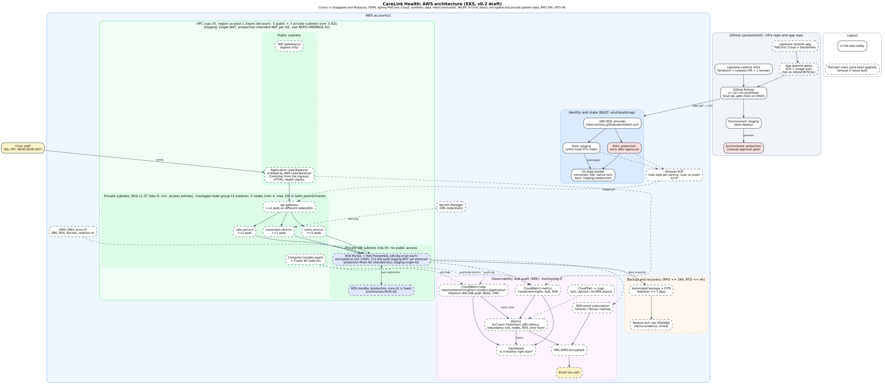

# CareLink Health: Architecture (DRAFT v0.2, EKS)

> Status: draft by Jon (SRE) supporting the team. Reflects the team's plan (EKS, per `adrs/0001`) and the 24 Oct repo (commit 8d95781: vpc, kms, eks, ecr, rds written in `infra/`; `eks-access.tf` and `monitoring.tf` not yet). Dashed boxes are **written but not confirmed applied, or still planned**; see `REPO-FINDINGS.md` for gaps between the code and the constraints. Check with the team which environments have actually been applied; per the brief this document must match what is **actually deployed**, so update it as `vpc.tf`, `kms.tf`, `eks.tf`, `eks-access.tf`, `ecr.tf`, `rds.tf` and `monitoring.tf` are applied. **[owner]** marks facts the file owner must confirm.

Source: `architecture-diagram.dot` (`dot -Tpng -Gdpi=130 architecture-diagram.dot -o architecture-diagram.png`).

## 1. Requirements summary
CareLink runs a telehealth booking and consultation-notes platform for clinics in Singapore and Malaysia. We demonstrate it with Spring PetClinic Cloud (api-gateway, customers, vets, visits services plus a database), synthetic data only.

- **Functional:** multi-service app on an AWS container platform with persistent database-backed operation.
- **Non-functional:** 99.9% availability in clinic hours (08:00-20:00 SGT, about 21.6 min allowed downtime per 30 days); no single point of failure in the application tier; survive loss of one application instance; RPO <= 24 h; RTO <= 4 h.
- **Hard constraints:** patient data encrypted at rest and in transit; database not publicly accessible; production data access restricted and logged; automated backups and a demonstrated restore.
- **Assumptions [owners]:** **region is `us-east-1` by team decision** (matches the code); the PDPA cross-border position is recorded honestly in ADR 0007; staging is a cost-reduced copy (single NAT, single-AZ RDS; note both environments currently run the same node group, 5 desired, min 4, max 10, per `eks.tf`) while production is *intended* to be Multi-AZ (not yet true in code, REPO-FINDINGS A1); staging is torn down when idle.

## 2. Service selection (what / alternative / why)

| Component | Chosen | Alternative | Why (constraint link) |
|---|---|---|---|
| Runtime | EKS (version set by `eks_cluster_version`, currently 1.37; EKS upgrades must go one minor version at a time), managed node group (ADR 0001) | ECS Fargate | Upstream PetClinic Cloud is Kubernetes-native; pods spread across AZs give no-SPOF; trade-off is control-plane cost and more operations. |
| Database | RDS MySQL/PostgreSQL, Multi-AZ in production (ADR 0004) | Self-managed DB in pods; Aurora | Managed encryption, backups, PITR, automatic failover. |
| Network | VPC, 3 public + 3 private subnets, NAT | Public subnets for nodes | Database and nodes stay private. |
| CI/CD | GitHub Actions + OIDC (ADR 0002) | Jenkins; stored keys | Keyless short-lived credentials; approval gate. |
| IaC / state | Terraform, S3 native locking (ADR 0003) | CloudFormation; DynamoDB locks | Plan review in PRs; no extra lock table. |
| Observability | CloudWatch + Container Insights + SNS (ADR 0005) | Prometheus/Grafana, OpenSearch | No servers to run; SLO alarms from code. |
| Keys / secrets | KMS CMKs, Secrets Manager | AWS-managed keys; env vars | Rotation, audit, nothing in code or images. |

## 3. Constraint compliance mapping (evidence to show)

| Hard constraint | Design decision | Evidence |
|---|---|---|
| 99.9% in clinic hours | >= 2 pods per service across nodes/AZs, Multi-AZ ALB and RDS, SLO burn alarms | Live: scale a service to 1 replica or drain a node, site stays up, `redundancy-lost` email, recovery; dashboard SLI vs SLO. |
| No SPOF in app tier | Node groups over 3 AZs; **pod anti-affinity / topology spread and PodDisruptionBudgets in the deployment config [Jack]** | `kubectl get pods -o wide` showing pods on different nodes/AZs. |
| Encrypted at rest | RDS CMK, EBS CMK, encrypted logs, SNS and S3 state | Console flags / `describe-db-instances`. |
| Encrypted in transit | TLS at ALB; DB requires TLS **[Krisna]** | Browser padlock; non-TLS DB connection refused. |
| DB not public | Private DB subnets, `publicly_accessible=false`, SG allows only node/pod traffic on the DB port | SG listing; failed connection from outside. |
| Data access restricted and logged | No standing human DB access; EKS access entries scoped (eks-access.tf); DB audit/error logs to CloudWatch (365 d); CloudTrail with alarms | Audit log group; CloudTrail event; security alarms. |
| RPO <= 24 h | Automated backups + PITR, >= 7 d retention | Backup retention, latest restorable time. |
| RTO <= 4 h | Multi-AZ failover; documented restore runbook with timed staging drill | Drill record in `docs/sre/runbooks/db-instance-failure.md`. |
| Staging cannot touch production | Per-environment roles, separate state keys, account guard-rail | Trust policy JSON; failed cross-environment attempt (REVIEW-NOTES items 1-2). |

## 4. Monthly cost estimate (full version: `docs/monthly-cost-estimate.md`)
About $659/month with both environments running all month, about $476 if staging is only up ~160 h/month (us-east-1 list prices, 25 Oct 2026; re-check in the AWS Pricing Calculator). Drivers: **EKS control plane fee (per cluster-hour, x2 if two clusters)**, node group EC2 + EBS, NAT gateways (production: 3; staging: 1; consider VPC endpoints), RDS Multi-AZ vs single-AZ, ALB, CloudWatch log ingestion and storage, alarms and dashboard (small), KMS keys, ECR storage. Two EKS clusters plus NAT gateways are likely the largest fixed costs: say so and show staging teardown. Add an AWS Budget alert filtered on `Project=capstone-project-group-03` (the cohort tag every resource carries via Terraform `default_tags`; it also exempts our resources from the instructors' nightly cleanup).

## 5. ADRs
Team ADRs in `adrs/`: 0001 EKS over ECS, 0002 keyless OIDC, 0003 native S3 locks, 0004 Multi-AZ RDS and backups. Proposed additions in `docs/adr/` (move to `adrs/`): 0005 observability and SLO alerting (SRE), 0006 environment isolation (needs team decision, REVIEW-NOTES items 1-2), 0007 region and PDPA (SA). The brief needs >= 4; each must match the deployed system.
