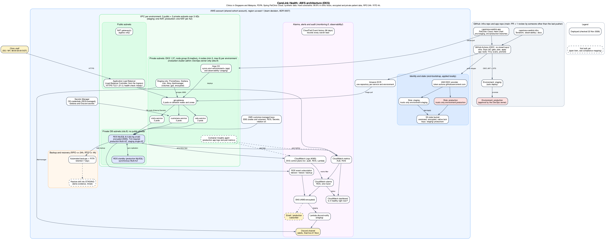

# CareLink Health: Architecture

> Status: living document, first drafted by Jon (SRE). Per the brief it must match what is **actually deployed**, so update it with every change to `infra/`. Open gaps and their owners are tracked in `docs/compliance-mapping.md`. Dashed boxes in the diagram are planned or not yet built. **[owner]** marks facts the file owner must confirm.

Source: `architecture-diagram.dot` (`dot -Tpng -Gdpi=130 architecture-diagram.dot -o architecture-diagram.png`).

## 1. Requirements summary
CareLink runs a telehealth booking and consultation-notes platform for clinics in Singapore and Malaysia. We demonstrate it with Spring PetClinic Cloud (api-gateway, customers, vets, visits services plus a database), synthetic data only.

- **Functional:** multi-service app on an AWS container platform with persistent database-backed operation.
- **Non-functional:** 99.9% availability in clinic hours (08:00-20:00 SGT, about 21.6 min allowed downtime per 30 days); no single point of failure in the application tier; survive loss of one application instance; RPO <= 24 h; RTO <= 4 h.
- **Hard constraints:** patient data encrypted at rest and in transit; database not publicly accessible; production data access restricted and logged; automated backups and a demonstrated restore.
- **Assumptions [owners]:** **region is `us-east-1` by team decision** (matches the code); the PDPA cross-border position is recorded honestly in ADR 0007; staging is a cost-reduced copy (single NAT, single-AZ RDS; note both environments currently run the same node group, 4 desired, min 3, max 6, per `eks.tf`, sized from measured use on 20 Nov) while production runs one NAT per AZ and Multi-AZ MySQL (A1 closed, `vpc.tf` and `rds.tf`). Both environments run continuously; the instructors' nightly cleanup is absorbed by the recovery scripts (ADR 0003).

## 2. Service selection (what / alternative / why)

| Component | Chosen | Alternative | Why (constraint link) |
|---|---|---|---|
| Runtime | EKS (version set by `eks_cluster_version`, currently 1.37; EKS upgrades must go one minor version at a time), managed node group (ADR 0001) | ECS Fargate | Upstream PetClinic Cloud is Kubernetes-native; pods spread across AZs give no-SPOF; trade-off is control-plane cost and more operations. |
| Database | RDS MySQL, Multi-AZ in production (ADR 0004) | Self-managed DB in pods; Aurora | Managed encryption, backups, PITR, automatic failover. |
| Network | VPC, 3 public + 3 private subnets, NAT | Public subnets for nodes | Database and nodes stay private. |
| CI/CD | GitHub Actions + OIDC (ADR 0002) for build, scan and promotion; Argo CD in each cluster applies the Helm chart from `env/<environment>` (ADR 0008) | Jenkins; stored keys; `kubectl apply` from CI | Keyless short-lived credentials; production approval gate; Git records every deployment and Argo CD restores the app after a rebuild. |
| IaC / state | Terraform, S3 native locking (ADR 0003) | CloudFormation; DynamoDB locks | Plan review in PRs; no extra lock table. |
| Observability | Staging: Prometheus, Grafana, Loki, Alloy and Alertmanager (to Discord), deployed by Argo CD from `observability/`. Both environments: CloudWatch alarms, dashboard and SNS (`monitoring.tf`, ADR 0005) | OpenSearch; CloudWatch only | Prometheus and Loki give app metrics, logs and SLOs without extra AWS services; CloudWatch covers the AWS side (RDS, alarms). Production in-cluster monitoring is an open SRE item. |
| Keys / secrets | KMS CMKs, Secrets Manager | AWS-managed keys; env vars | Rotation, audit, nothing in code or images. |

## 3. Constraint compliance mapping (evidence to show)

| Hard constraint | Design decision | Evidence |
|---|---|---|
| 99.9% in clinic hours | >= 2 pods per service across nodes/AZs, Multi-AZ ALB, Multi-AZ RDS in production, SLO recording rules and burn-rate alerts (staging) | Live: drain a production node, the site stays up; Prometheus SLO queries. |
| No SPOF in app tier | Node group over 3 AZs; 2 replicas per service with topology spread (nodes required, zones preferred) and PodDisruptionBudgets (app chart) | `kubectl get pods -o wide` showing pods on different nodes and zones. |
| Encrypted at rest | KMS keys for RDS, node disks and Kubernetes volumes (default `gp3-encrypted` storage class); encrypted logs, SNS and S3 state | `describe-db-instances`; `describe-volumes`. |
| Encrypted in transit | TLS 1.2/1.3 at the ALB; MySQL requires TLS | Browser padlock; a non-TLS DB connection is refused. |
| DB not public | Private DB subnets, `publicly_accessible=false`, SG allows only node/pod traffic on the DB port | SG listing; failed connection from outside. |
| Data access restricted and logged | No standing human DB access; in production only the DevOps owner is cluster admin, teammates are view-only (`eks.tf`); CloudTrail Event history records secret reads; EKS audit logs to CloudWatch; DB audit logging not enabled yet | `aws eks list-associated-access-policies`; CloudTrail `GetSecretValue` events. |
| RPO <= 24 h | Automated backups + PITR, >= 7 d retention | Backup retention, latest restorable time. |
| RTO <= 4 h | Multi-AZ failover; documented restore runbook with timed staging drill | Drill record in `docs/sre/runbooks/db-instance-failure.md`. |
| Staging cannot touch production | Per-environment roles with exact OIDC trust, separate state keys enforced by the bucket policy (ADR 0002, ADR 0006) | Trust policy JSON; a staging job cannot assume the production role. |

## 4. Monthly cost estimate
About $790/month with both environments running all month (us-east-1 list prices from the AWS Price List API, 20 Nov 2026), including about $50 for the two unused PostgreSQL instances. Drivers: **EKS control plane fee (per cluster-hour, x2 if two clusters)**, node group EC2 + EBS, NAT gateways (production: 3; staging: 1; consider VPC endpoints), RDS Multi-AZ vs single-AZ, ALB, CloudWatch log ingestion and storage, alarms and dashboard (small), KMS keys, ECR storage. Two EKS clusters plus NAT gateways are likely the largest fixed costs: say so and show staging teardown. Add an AWS Budget alert filtered on `Project=capstone-project-group-03` (the cohort tag every resource carries via Terraform `default_tags`; it also exempts our resources from the instructors' nightly cleanup).

## 5. ADRs
In `docs/adr/`: 0001 EKS runtime, 0002 keyless OIDC pipelines, 0003 Terraform state with S3 native locking, 0004 RDS Multi-AZ and backups, 0005 observability and SLO alerting, 0006 environment isolation, 0007 region and PDPA, 0008 GitOps with Argo CD. Each must match the deployed system.
